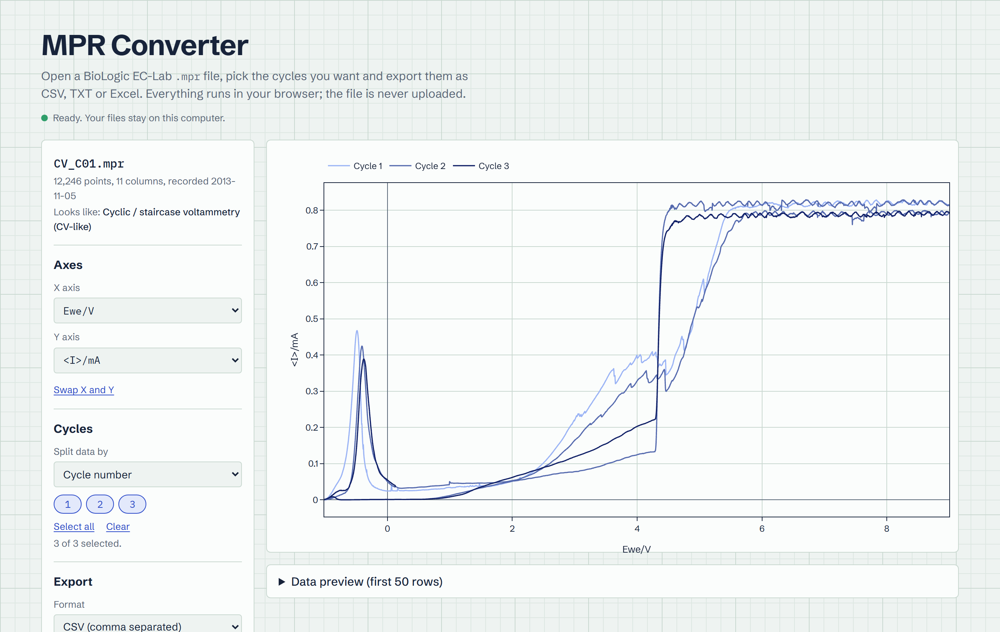

# MPR Converter

Open BioLogic EC-Lab `.mpr` files in the browser, plot them by cycle and export the data as CSV, tab-separated TXT (for Origin) or Excel.

**Live demo:** _add your Vercel URL here_



## Why

EC-Lab's `.mpr` files are binary, so getting the data into Python, Excel or Origin usually means opening EC-Lab on the instrument PC and exporting by hand. This tool does it in a browser tab, on any computer.

- **Private by design.** The file is read by Python running inside your browser ([Pyodide](https://pyodide.org)). Nothing is uploaded, and there is no server.
- **Cycle aware.** Split by cycle number, full cycle, half cycle (charge/discharge) or technique sequence. Plot any subset and export one file per cycle.
- **No sign-up, no install.** A static site on Vercel.

## How it works

```
browser tab
├── index.html / app.js     UI, Plotly chart, file downloads (SheetJS, JSZip)
└── worker.js               Web Worker: runs Pyodide so the page never freezes
    └── py/core.py          load .mpr, guess technique, split cycles, export
        └── py/galvani/     .mpr reader from the galvani project
```

`py/core.py` has no UI code, so the same module also runs as plain Python on your machine (see the tests).

## Run locally (VS Code)

1. Open the folder in VS Code and install the recommended extensions (Live Server, Python).
2. Right-click `index.html` and choose **Open with Live Server**.
   The page must be served over http(s); opening the file directly (`file://`) blocks the Web Worker.
3. Test the Python logic without a browser:

   ```bash
   pip install numpy pytest
   pytest tests/
   ```

## Deploy to Vercel

1. Push the folder to a GitHub repository.
2. On vercel.com choose **Add New, Project**, import the repository, and leave every setting at its default (Framework preset: Other, no build command).
3. Every push to `main` redeploys.

## Supported files

Tested with cyclic voltammetry, galvanostatic cycling (GCPL) and chronoamperometry files from the galvani test set. The technique shown in the UI is a guess from the columns in the file; the data itself is read exactly as stored. Files from very new EC-Lab versions may contain column IDs the reader doesn't know yet; the page then shows the error.

## Credits and license

- `.mpr` parsing: [galvani](https://github.com/echemdata/galvani) by Christopher Kerr and contributors, GPL-3.0-or-later. A copy of `galvani/BioLogic.py` is included in `py/galvani/`.
- Sample files in `samples/`: from the galvani test data, CC-BY-4.0 (see `samples/README.md`).
- Because it includes galvani, this project is licensed under **GPL-3.0-or-later** (see `LICENSE`).
